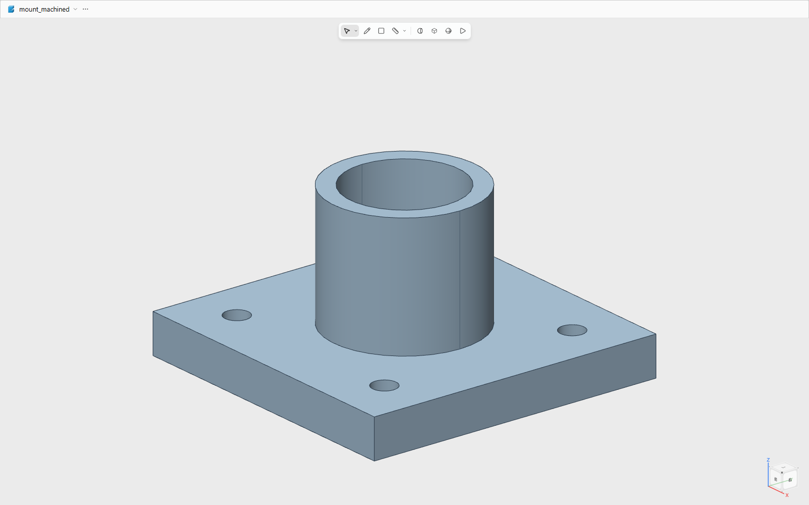

# dsh-cad-panel [](https://github.com/deepseek-ai/deepseek-harness)

**简体中文** · [English](README_en.md)

[](https://github.com/Kongbaige010/dsh-cad-panel) [](LICENSE)

把 text-to-cad 的实时三维视图接进 DSH 右侧栏：点一下输入框左侧的 `CAD` 胶囊就能看模型，模型重建时面板自己刷新。

> 第三方插件，非 DSH 官方产物。与 DeepSeek、Thompson Labs 均无隶属关系。



## 能做什么

| 能力 | 说明 |
|---|---|
| 右侧栏实时面板 | 点输入框左侧的 `CAD` 胶囊，右侧栏 dock 打开实时三维视图，再点一次收起 |
| 构建自动展开 | 模型真正重建时自动打开面板；不抢焦点，也不在页面加载时弹 |
| 会话内看图 | 配合 `preview/` 管线，把最新一次渲染贴进对话 |
| 离线可旋转页 | 生成单文件 `cad-preview.html`，three.js 与几何全部内联，双击即开 |
| 前后对比图 | 同机位渲染两张并圈出改动位置，用来核对到底改了什么 |

## 安装

```bash
git clone https://github.com/Kongbaige010/dsh-cad-panel.git ~/.dsh/local-plugins/dsh-cad-panel
bash ~/.dsh/local-plugins/dsh-cad-panel/repatch-engine-csp.sh
```

再在 DSH 里把该目录加为本地 bundle，重载页面即可。逐步说明见 [INSTALL.md](INSTALL.md)。

## 使用

- 点 `CAD` 胶囊开关面板；面板已开时不会重复抢焦点。
- 跑一次 `cad run` 重建模型，面板会自己刷新——文档 id 不随重建变化。
- 想要离线预览页：`bash preview/refresh-preview.sh <模型脚本.py> <输出目录>`。

## 为什么自动展开只认 built

引擎每次打开文档都会改写 `opened` / `preview` 字段与目录时间戳。用它们触发会形成自激循环（面板一开 → 时间戳变 → 再开 → …），表现为右侧栏疯狂弹开。只有 `built` 在真正重建时才变，所以它是唯一可信的触发源。

## 适用版本

引擎侧补丁是对 `cad-server` **0.11.9** 的文件级改写。`cad update` 升级后补丁会失效，重跑 `repatch-engine-csp.sh` 即可；若上游改动过大导致脚本报错，请提 issue。

## 目录结构

```
lib/client.js              客户端：胶囊按钮、dock tab、构建监听
lib/index.js               宿主：token 预热（全程 try/catch，绝不阻断 DSH 启动）
preview/make-preview.py    GLB + three.js → 单文件 HTML
preview/refresh-preview.sh 一键：构建 → 导出 → 生成 → 截图
preview/make-diff-sheet.py 同机位前后对比 + 投影圈注
icon.svg                   插件图标（36×36，跟随主题色）
locale/                    界内标题与描述（zh 与 en 键完全一致）
```

## 许可

MIT。内联的 three.js r147 同为 MIT，依赖与版权声明见 [THIRD-PARTY-NOTICES.md](THIRD-PARTY-NOTICES.md)。
