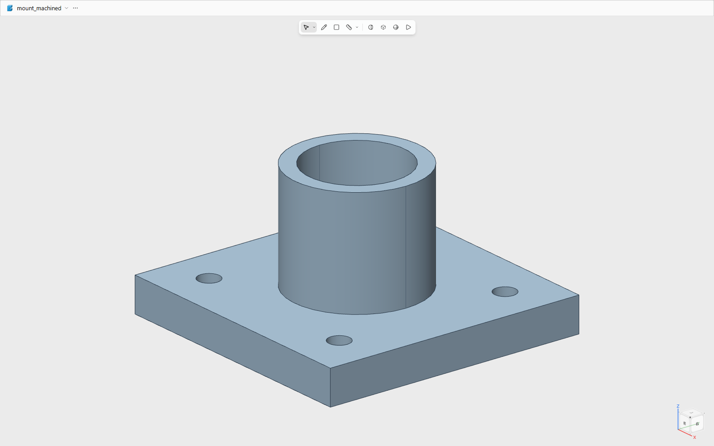

# dsh-cad-panel [](https://github.com/deepseek-ai/deepseek-harness)

[简体中文](README.md) · **English**

[](https://github.com/Kongbaige010/dsh-cad-panel) [](LICENSE)

Brings the text-to-cad live 3D viewer into DSH's right sidebar: click the `CAD` chip left of the composer to see the model, and the panel refreshes itself whenever the model is rebuilt.

> A third-party plugin. Not an official DSH product, and not affiliated with DeepSeek or Thompson Labs.



## What it does

| Capability | What it means |
|---|---|
| Live side panel | Click the `CAD` chip left of the composer to open the live 3D view in the right dock; click again to close it |
| Auto-expand on build | The panel opens by itself when the model is really rebuilt; it never steals focus and never opens on page load |
| Images in chat | The `preview/` pipeline drops the latest render straight into the conversation |
| Offline rotatable page | Emits a single-file `cad-preview.html` with three.js and the geometry inlined; double-click to open |
| Before/after sheet | Renders two shots from the identical camera and circles what changed, so you can verify the diff |

## Install

```bash
git clone https://github.com/Kongbaige010/dsh-cad-panel.git ~/.dsh/local-plugins/dsh-cad-panel
bash ~/.dsh/local-plugins/dsh-cad-panel/repatch-engine-csp.sh
```

Then add that directory as a local bundle in DSH and reload the page. Step-by-step notes: [INSTALL.md](INSTALL.md) (Chinese).

## Usage

- Click the `CAD` chip to toggle the panel; it will not steal focus when already open.
- Run `cad run` to rebuild the model and the panel refreshes itself — the document id survives rebuilds.
- For an offline preview page: `bash preview/refresh-preview.sh <model.py> <output-dir>`.

## Why auto-expand only trusts built

Opening a document rewrites its `opened` / `preview` fields and the directory mtime, so triggering on those creates a self-feeding loop (panel opens → timestamp changes → open again → …) that looks like the sidebar opening on its own forever. Only `built` changes on a real rebuild, which makes it the only trustworthy trigger.

## Supported versions

The engine-side patches rewrite files of `cad-server` **0.11.9**. A `cad update` wipes them, so re-run `repatch-engine-csp.sh`; if upstream changed too much for the script, please open an issue instead of patching by hand.

## Layout

```
lib/client.js              client: CAD chip, dock tab, build watcher
lib/index.js               host: token warm-up (all wrapped in try/catch so DSH always boots)
preview/make-preview.py    GLB + three.js → single-file HTML
preview/refresh-preview.sh one shot: build → export → render → screenshot
preview/make-diff-sheet.py identical-camera before/after with projected callouts
icon.svg                   plugin icon (36×36, follows the theme colour)
locale/                    in-app title and description (zh and en keys are identical)
```

## License

MIT. The inlined three.js r147 is MIT as well; see [THIRD-PARTY-NOTICES.md](THIRD-PARTY-NOTICES.md) for third-party notices.
