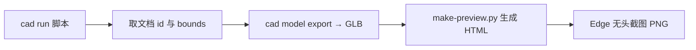

# CAD 预览三件套（会话内看图 + 会话外可旋转）

DSH 的聊天消息**不解析原始 HTML**（渲染器没有 `rehype-raw`），所以 `<iframe>` 塞不进会话。
这份目录提供两条互补的路子：

| 用途 | 产物 | 怎么看 |
|---|---|---|
| 会话里扫一眼 | `preview-shot.png` | 我贴在回复里（Markdown 图片） |
| 想自己转着看 | `cad-preview.html` | **双击**即可，单文件、离线、无依赖 |

## 一条命令刷新

```bash
bash ~/.dsh/local-plugins/dsh-cad-panel/preview/refresh-preview.sh \
     /path/to/your/model.py \
     /path/to/out-dir
```

它按顺序做四件事：



## 为什么是单文件 + 经典脚本

实测过的两个坑，写在这里省得再踩：

1. **`file://` 下浏览器拒绝加载 ES 模块**（CORS），用 `type="module"` + importmap 的页面
   双击打开只会显示一片空白。改用经典脚本（`three.min.js` r147 一类）就没有这个限制。
2. **GLB 是 glTF 惯例的 Y 轴朝上**，不是 CAD 的 Z 轴朝上。相机用默认 `up` 才不会歪；
   `GridHelper` 也默认躺在 XZ 平面，别去转它。

`vendor-classic/` 里的三个文件只需首次联网下载一次，之后永久离线可用：

```bash
B=https://cdn.jsdelivr.net/npm/three@0.147.0
curl -o vendor-classic/three.min.js        $B/build/three.min.js
curl -o vendor-classic/GLTFLoader.js       $B/examples/js/loaders/GLTFLoader.js
curl -o vendor-classic/OrbitControls.js    $B/examples/js/controls/OrbitControls.js
```

## 文件说明

| 文件 | 说明 |
|---|---|
| `make-preview.py` | 生成器：GLB + three.js → 单文件 HTML，可顺带截图验证 |
| `refresh-preview.sh` | 一键串起构建→导出→生成→截图 |
| `make-diff-sheet.py` | 同机位前后对比图 + 改动位置投影圈注 |
| `vendor-classic/` | 经典脚本版 three r147（内联进 HTML，MIT） |

## 许可

本目录代码为 MIT。内联的 three.js r147 同为 MIT，版权归 Three.js Authors；
完整的第三方声明见仓库根 `THIRD-PARTY-NOTICES.md`。

本项目是**第三方插件，非 DSH 官方产物**。

## 也可以在右侧栏看

右侧栏的「文档预览」支持 `.html`，把 `cad-preview.html` 拖进去同样能转（它内部也用
带 `allow-scripts` 的沙箱 iframe 加载）。会话里则只贴 PNG。
